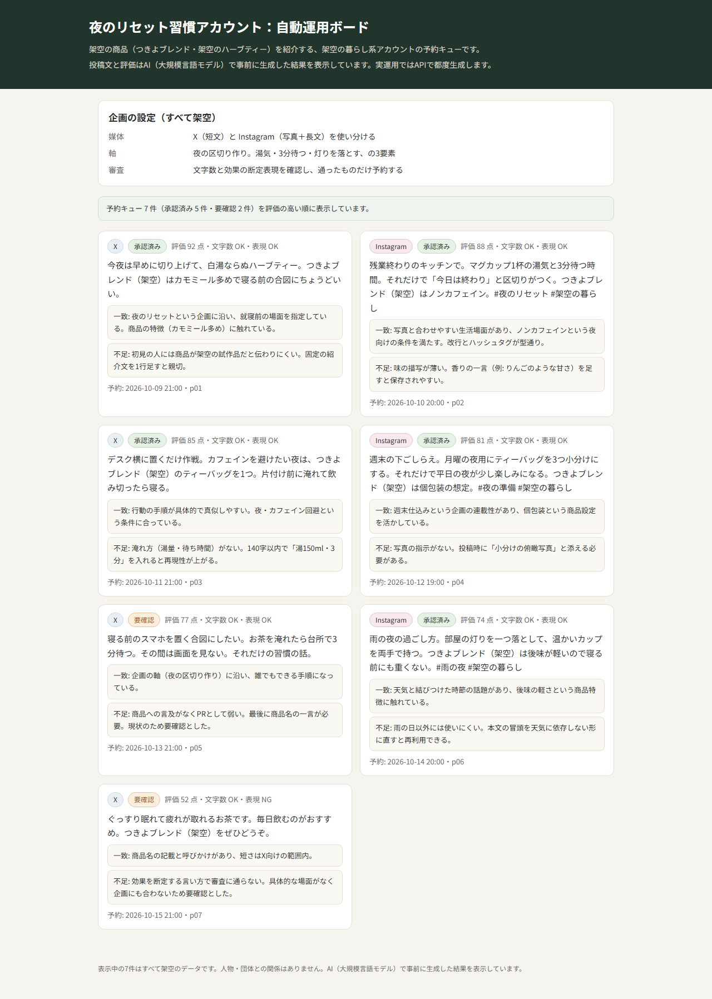
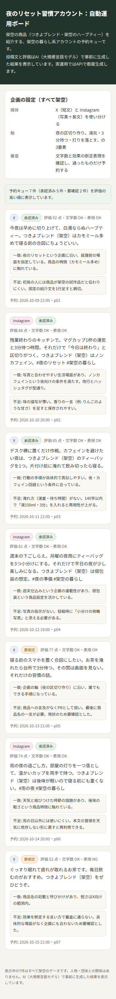

# SNS自動運用ボード（POC）

架空の商品を紹介する架空の暮らし系アカウントが、1週間分の投稿を自動で作り、審査して予約する流れの見本です。
投稿文と評価はAI（大規模言語モデル）で事前に生成した結果を表示している。実運用ではAPIで都度生成する。
データはすべて架空で、`data/posts.json` に同梱しています。外部APIは呼びません。

## このPOCで確かめたこと

- 架空の投稿案7件を評価の高い順に予約キューとして表示できる（承認済み5件・要確認2件）
- 各投稿案に媒体（X / Instagram）、本文、評価点、一致点と不足点の理由、予約日時、審査結果を付けられる
- 効果を断定する表現の投稿案は審査NGとして予約対象から外せる（1件が該当し「要確認」になる）
- 画面を開いた直後に結果の一覧が見える（`docs/index.html` の初期表示で7件表示）

## 作っていない範囲

- 実際の投稿予約やSNSへの投稿
- 媒体の自動選定や費用・期間の見積もり
- APIによる投稿文の都度生成

## 次の進め方

- 通った型だけを残し、商品や季節を変えて投稿案を追加する
- 審査の観点（文字数・断定表現・企画との一致）を調整する
- 実運用では生成APIと予約機能につなぎ、人間の承認を挟む

## 動かし方

- 画面: `docs/index.html` をブラウザで開く
- テスト: `npm install` 後に `npm test`

